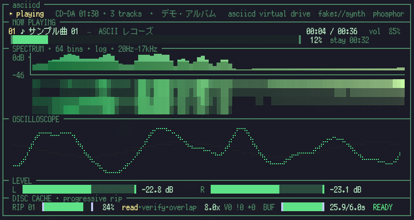

# asciicd

[](https://github.com/Respoint0123/ASCII_CD_PLAYER/actions/workflows/test.yml)

**在 Linux 终端里听实体 CD。** asciicd 是一个 CD-DA 播放器，边抓轨边播放，并用字符画出实时频谱、瀑布图和示波器。界面灵感来自老式车载 CD 机。

Linux terminal audio CD player with progressive ripping and live character-art visualizations.



## 快速开始

从 [Releases](https://github.com/Respoint0123/ASCII_CD_PLAYER/releases) 下载 v0.1.0 的 Linux 分发包并解压，在解压目录里运行下面的命令。

### 1. 安装依赖

需要 Linux、Python 3.10+、NumPy、`pw-cat` 和运行中的 PipeWire 音频会话。播放实体 CD 还需要音频光驱和 `cdparanoia`。只想试玩 `--fake` 时，可以从下面的命令里去掉 `cdparanoia`。

```sh
# Arch Linux
sudo pacman -S python python-numpy cdparanoia pipewire-audio

# Ubuntu 24.04
sudo apt install python3 python3-numpy cdparanoia pipewire-bin
```

### 2. 安装 asciicd

```sh
./install.sh              # 复制到 ~/.local/share/asciicd，装命令软链和桌面菜单项
./install.sh --add-path   # 可选：把 ~/.local/bin 加进 PATH（重开终端生效）
```

安装器只写用户目录，解压包之后可以删。卸载用 `~/.local/share/asciicd/install.sh --uninstall`。不想安装也可以直接运行解压目录里的 `python3 asciicd.pyz`。

### 3. 试玩合成光盘

```sh
asciicd --check-deps --fake
asciicd --fake
```

演示模式会播放合成音乐。按 `Space` 开始或暂停，按 `q` 退出。

### 4. 播放音频 CD

```sh
asciicd --check-deps
asciicd --wait-disc
```

插入音频 CD，看到 `CD READY` 后按 `Space`。默认插盘后等待手动播放，想自动播放可以加 `--on-insert play`。开仓会立即停止。多光驱时可用 `--list-devices` 查看设备，再用 `--device /dev/sr1` 指定。

装有 Kitty 时，`asciicd` 会打开一个独立的点阵字体窗口；没有 Kitty 且从桌面菜单启动时，会借用系统里可用的终端模拟器，两者都没有则直接报错退出。`asciicd --version`、`--help` 和 `--check-deps` 始终留在你调用它的终端里。

## 操作

| 按键 | 功能 |
| --- | --- |
| `Space` | 播放或暂停 |
| `s` | 停止并回到本轨开头，同时暂停后台抓轨 |
| `←` / `→` | 后退或前进 5 秒 |
| `↑` / `↓` | 调节音量 |
| `n` / `p` | 下一轨或上一轨 |
| `1`–`9` | 跳到对应轨道 |
| `r` | 重播当前轨 |
| `l` / `m` | 切换仪表盘和极简布局 |
| `t` | 切换配色 |
| `h` | 查看按键帮助 |
| `q` | 退出 |

```sh
asciicd --layout mini    # 窄窗口用极简布局
asciicd --theme jpop     # 也可选 phosphor、amber、modern
asciicd --version        # asciicd 0.1.0
asciicd --help
```

## 读盘、缓存与曲名

- 播放从临时 PCM 缓存读取音频，光驱在后台继续抓轨。默认预读当前轨和下一轨，读盘跟不上时会自动缓冲。首次出声的时间取决于光驱和盘况。
- 正常退出或更换光盘时清理临时音频，保留曲名缓存。可用 `--rip-mode track` 只抓当前轨，或用 `--rip-mode disc` 预抓整盘。
- 首次播放时按需向 MusicBrainz 查询曲名。查询会发送光盘 ID，回退查询时会发送 TOC（含各轨的起始位置）。使用 `--no-metadata` 可关闭联网查询，仍可读取盘上的 CD-TEXT 和本地曲名缓存。
- `--fake` 使用独立的缓存目录，不会影响正在播放的真盘。

## 问题反馈与开发

欢迎在本仓库的 **Issues** 报告问题。请附上 asciicd 版本（`asciicd --version`）、Linux 发行版、光驱型号、复现步骤，以及 `--check-deps` 的输出。也可以注明能否用 `--fake` 复现。

源码入口是 `python3 asciicd.py`。需要 Python 3.10+、NumPy 和开发依赖：

```sh
python3 -m venv .venv
. .venv/bin/activate
python3 -m pip install numpy -r requirements-dev.txt
make test
make lint
make build          # 生成 dist/asciicd-v0.1.0-linux.tar.gz
make check-dist     # 验收产物：文件、权限、字体、许可、归档、CLI 版本
make smoke          # 伪终端冒烟：画面、退出码、终端恢复
```

## 许可

项目代码以 **MIT** 发布，见仓库根目录的 `LICENSE`。随包字体不适用 MIT：PixelMplus12 用 M+ FONT LICENSE，GNU Unifont 16.0.04 为双许可（SIL OFL 1.1 / GPLv2+，本包按 OFL 分发）。版本、来源、SHA-256 和完整许可文本见 [字体声明](assets/fonts/README.md)。
